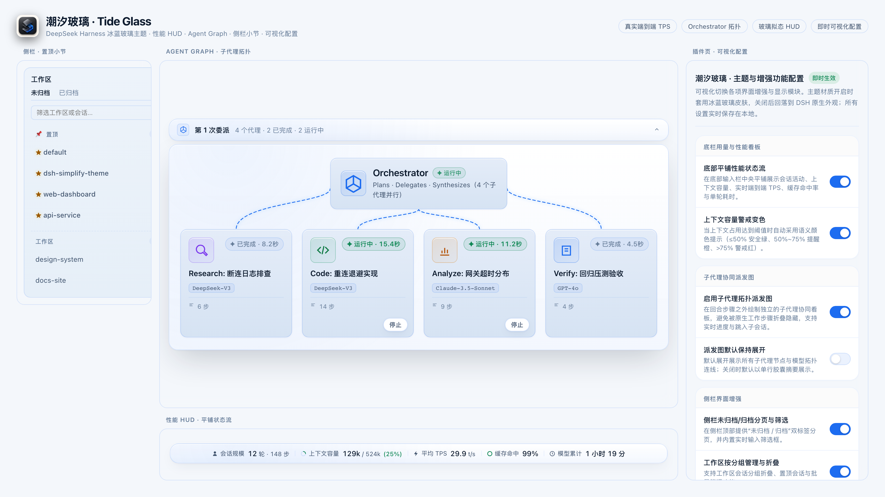
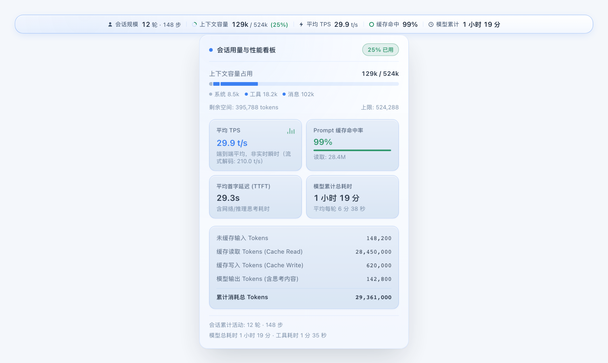
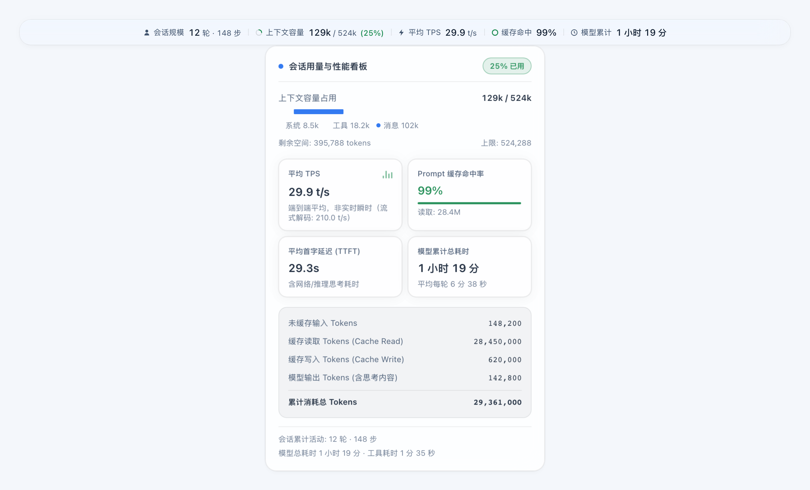
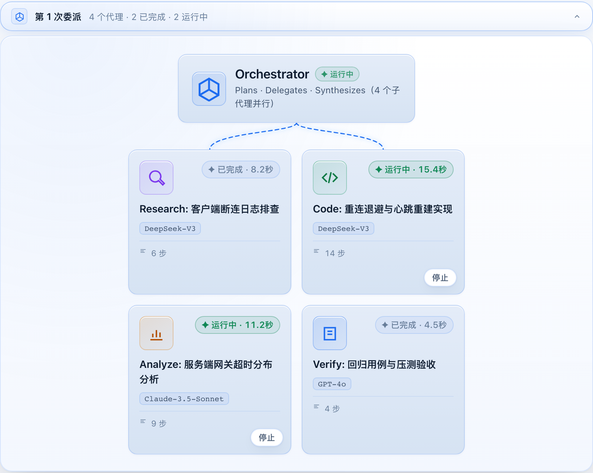
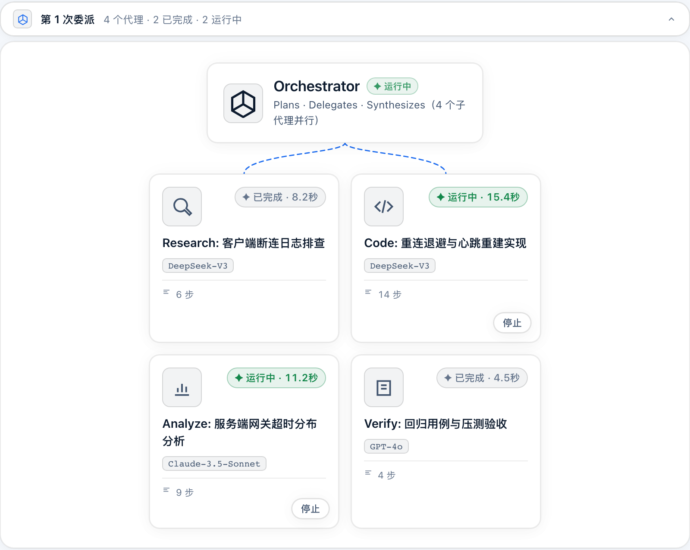
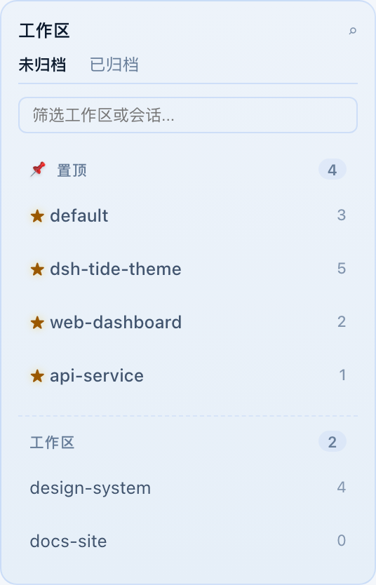
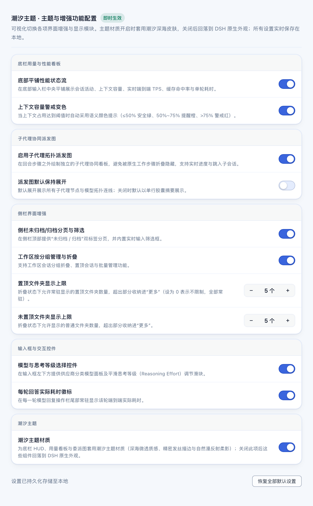
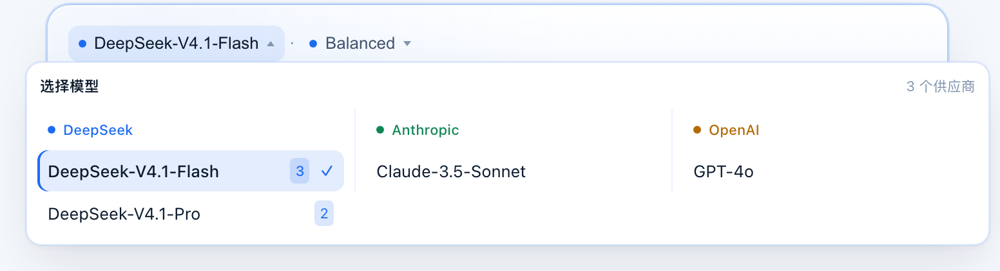

# 潮汐主题 · Tide Theme

<p align="center">
  
</p>

<p align="center">
  <strong>深海潮汐蓝、真实指标、零噪音 —— 给 DeepSeek Harness 的主题与工作流增强套件</strong>
</p>

<p align="center">
  <a href="https://www.npmjs.com/package/dsh-tide-theme"></a>
  <a href="https://github.com/awesome-dsh-plugin/awesome-dsh-plugin"></a>
  <a href="LICENSE"></a>
</p>

> **关于名字**：本插件原名 `dsh-simplify-theme`（极简主题），后更名为 **`dsh-tide-theme`**（潮汐主题 · Tide Theme）。
> 如果你是从旧包升级过来的，请先卸载旧包再安装新包；本地配置需重新设置一次（存储键已随包名更新）。

---

<p align="center">
  <picture>
    <source media="(prefers-color-scheme: dark)" srcset="docs/images/banner-dark.png" />
    
  </picture>
</p>

Tide Theme 为 DSH 提供深海潮汐蓝的表面体系、清晰的文字层级与克制的信息密度，并完整保留宿主的对话、导航及分屏结构。

本文的功能截图由插件组件在隔离浏览器中使用演示数据渲染，用于展示组件样式；它们不代表当前用户会话或完整 DSH 应用的实际界面。真实宿主的布局与交互另外通过宿主结构契约测试验证。

---

## 设计基线

主题遵循一套固定的设计契约，而不是逐处调色。改动前先读 `docs/ui-design-contract.md`。

### 配色（6-3-1，单一 Token 来源）

| 占比 | 角色 | 暗色（深海暗潮） | 亮色（潮平岸阔） |
|---|---|---|---|
| **60%** | 主画布 / 侧栏 / 对话视口 | `#0b121e` · `#0e1726` | `#f5f8fc` · `#edf3fa` |
| **30%** | 卡片 Surface / 浮层 / 发丝描边 | `#142034` · `rgba(96,165,250,.16)` | `#ffffff` · `rgba(37,99,235,.12)` |
| **10%** | 唯一强调色（潮汐蓝） | `#38bdf8` / `#60a5fa` | `#1d4ed8` / `#2563eb` |

- **禁用纯黑 `#000000`**：底色取自深海蓝灰，最暗处仍保留色相。
- **单一强调色、饱和度克制**：状态色仅按语义扩展（成功 `#047857` / 警戒 `#b45309` / 失败 `#dc2626`），不引入第二主色。
- **无霓虹辉光、无蓝紫渐变**：不使用 `radial-gradient` 彩色光斑、`drop-shadow` 发光或彩色 `box-shadow: 0 0 Npx`；层次靠 0.5px 发丝边、明度台阶与融入背景的漫反射柔影建立。
- **对比度达标**：正文与辅助文字满足 WCAG AA（≥ 4.5:1），主标题与核心读数按 AAA（≥ 7:1）取值。

### 字阶与读数

| 层级 | 字号 / 行高 | 用途 |
|---|---|---|
| KPI 读数 | 16px / 20px | 看板大指标（TPS、TTFT、耗时） |
| HUD 读数 | 13px / 20px | 底栏常驻指标 |
| 正文 | 12px / 16px | 常规信息与选项 |
| 辅助说明 | 11px / 14px | 提示、单位、时间戳 |

- **度量读数一律等宽**：TPS、Token、耗时、百分比使用 `Geist Mono` → `JetBrains Mono` → `ui-monospace` 的字体栈，并开启 `font-variant-numeric: tabular-nums` 与 `font-feature-settings: "tnum" 1`，数值刷新时零抖动。
- **只使用整数像素字号**：不使用 10.5px / 11.5px 一类半像素值，避免 1x 屏子像素发虚。
- **不引入网络字体**：界面文本走宿主系统无衬线字体。

### 间距与状态

- **8pt 步长**：4px（图标与读数）/ 8px（HUD 单元格）/ 12px（卡片网格）/ 16px（浮层内衬）/ 24px（大区块）。
- **状态完整**：加载中（与正式尺寸 1:1 的骨架条）、空数据、错误/重试、超长文本截断（`min-width: 0` + `ellipsis`）、Hover / Active / Focus-visible / Disabled 均有独立实现。
- **焦点可见**：所有可聚焦控件（标签页、开关、步进器、重置按钮、停止按钮）均提供 2px 语义焦点环。
- **视口防御**：看板浮层限制 `max-height: min(560px, calc(100vh - 48px))` 并可内部滚动，矮视口不会截断内容。

---

## 主题材质开关

底栏 HUD、用量看板与委派图这三个自绘组件，**统一跟随插件设置里的主题材质开关**：

| 开关 | 三个组件的外观 | 预览 |
|---|---|---|
| **开启**（默认） | 套用潮汐材质：深海哑光微透表面、0.5px 发丝描边、自然漫反射柔影、克制的语义状态点 | 见下方各功能的「主题」图 |
| **关闭** | 全部回落到 DSH 原生 token 表面（`--dsw-specific-menu` / `--dsw-alias-bg-layer-*` / `--dsw-elevation-*`），与宿主外观完全一致 | 见下方各功能的「原生」图 |

开关位于 **设置 → 插件 → 潮汐主题 → 潮汐主题材质**，实时生效、无需重启。明暗两套配色各自成立，切换深浅色不会冷暖混用。

---

## 核心特性一览

### 1. 底栏性能 HUD 与用量看板

取代原生埋在弹窗里的统计胶囊，把关键运行指标固定在任何时候都看得见的位置：

<p align="center">
  <picture>
    <source media="(prefers-color-scheme: dark)" srcset="docs/images/current-dock-dark.png" />
    
  </picture>
</p>

<details>
<summary>对比：关闭主题材质后的原生外观</summary>

<p align="center">
  <picture>
    <source media="(prefers-color-scheme: dark)" srcset="docs/images/current-dock-dark-native.png" />
    
  </picture>
</p>
</details>

- **单行常驻 HUD**：会话规模、上下文容量、真实端到端 TPS、缓存命中率、模型累计耗时五项一行排布，形制对齐宿主原生 TodoPanel（36px 高、`radius-lg` 圆角）。窄屏按 760px / 640px 两级断点自动收窄，绝不截断读数。
- **加载态不突跳**：数据尚未就绪时渲染与正式高度一致的骨架条，数据到达后原位替换，不产生累积布局位移。
- **严格计入首字延迟（TTFT）的真实 TPS**：原生口径只算纯解码时间（会出现 200+ t/s 的虚高值）；本插件把网络往返与推理思考一并计入，还原真实生成速率。
- **上下文容量三档语义色**：≤50% 安全绿、50–75% 提醒琥珀、>75% 警戒红，进度条与徽章同步换色。
- **上下文压缩即时刷新**：接入 `projectedTokens` 与 `contextBreakdown`，压缩发生后容量读数立刻下降，不会停在旧采样值。
- **点击展开用量看板**：系统/工具/消息三段式容量条、四张性能 KPI 卡、Token 计费构成表与会话耗时拆解。浮窗**水平居中于 HUD、底边严丝合缝贴住 HUD 顶边**，空间不足时自动翻转到下方或贴视口底；内容超高时浮窗内部滚动。

---

### 2. Agent Graph 子代理拓扑

无论工作步骤是否被宿主折叠收起，子代理的派发记录始终常驻可见：

<p align="center">
  <picture>
    <source media="(prefers-color-scheme: dark)" srcset="docs/images/current-delegation-dark.png" />
    
  </picture>
</p>

<details>
<summary>对比：关闭主题材质后的原生外观</summary>

<p align="center">
  <picture>
    <source media="(prefers-color-scheme: dark)" srcset="docs/images/current-delegation-dark-native.png" />
    
  </picture>
</p>
</details>

- **弧形扇出连线**：SVG 按真实几何绘制——外侧分支从枢纽侧缘引出，内侧从底部引出，以贝塞尔曲线落到卡片顶边；有子代理运行时用 1px 语义色导线配合虚线流动表示活动，不加外发光。卡片换行时只画主干，避免连线穿过上一行卡片。
- **横向 Agent 卡片阵列**：网格按可用容器宽度排布，每张卡片保留标题、模型、状态与实际步骤数；步骤数不代表已完成的任务清单。
- **token 消耗与预估金额**：每张卡片显示该子代理的 token 用量（宿主四个互不重叠的用量桶之和），并在能查到单价时才追加预估金额。单价运行时从 [OpenRouter 公开模型目录](https://openrouter.ai/api/v1/models)拉取，按模型名归一化匹配（去供应商前缀、`.`/`_` 视同 `-`、容忍日期后缀）。四桶明细放在 `title` 里，便于核对口径。查不到单价就不显示金额，绝不编造数字；金额未处理 OpenRouter 的分时浮动定价，因此偏保守（偏高），仅供参考、不可用于计费。
- **四色职能映射**：按标题关键词把子代理归到 Research（天青）/ Code（绿）/ Analyze（琥珀）/ 其它（蓝），图标以单色前景 + 同色低透明度底呈现，不整卡套艳色渐变；关闭主题材质后统一回落为中性图标。
- **多轮次递增时序防冲突**：会话级单调递增编号（第 1 次委派、第 2 次委派…），配合行级粘性绑定（`claimedByRow`），杜绝跨轮次编号重置或盗用旧图。
- **宁可缺省也不张冠李戴**：无法确定某个工具行对应哪个子会话时**不显示**该节点（失败或仍在排队的 `spawn_teammate` 调用不会凭空占位），而不是按顺序猜一个。未匹配的错误本身仍原样留在原生工具行里。
- **交互**：点击卡片打开对应子会话；支持取消的运行中卡片提供独立「停止」按钮，停止操作不触发会话跳转。

---

### 3. 侧栏独立小节置顶

告别工作区文件夹混杂堆叠，用小节与发丝分割线重塑清晰层级：

<p align="center">
  <picture>
    <source media="(prefers-color-scheme: dark)" srcset="docs/images/current-sidebar-dark.png" />
    
  </picture>
</p>

- **小节标头**：置顶与普通文件夹分立为 `📌 置顶 (N)` 与 `工作区 (M)` 两小节，标头挂在工作区列表容器内部（不会漂到搜索框上方）。
- **置顶标识**：置顶项带语义琥珀色 `★` 前缀，与普通项之间用发丝虚线隔开。
- **选中侧条**：当前工作区左侧出现 3px 品牌蓝实心竖条，无外发光。
- **未归档 / 归档分页**：双标签页切换活跃状态，与宿主视图状态双向同步。
- **实时筛选框**：即输即搜，命中会话时保留其工作区组头。
- **数量上限独立可调**：置顶与未置顶的折叠上限分别配置（置顶设为 0 表示不限，全部常驻）。

---

### 4. 插件页可视化配置面板与架构契约

所有开关与步进器直接挂在 DSH 插件设置页，改动即时保存到 `localStorage`，无需重启或手改配置文件：

<p align="center">
  <picture>
    <source media="(prefers-color-scheme: dark)" srcset="docs/images/current-settings-dark.png" />
    
  </picture>
</p>

- 设置卡片套用与浮层同源的潮汐 Surface，明暗两套各自成立。
- 分组标题、各项说明、开关与步进器均复用语义 token，无硬编码色值。
- **官方配置契约**：以精准 key `dsh-tide-theme#dsh-tide-theme` 注册在 `plugins.row.config` 与 `plugins.bundle.config`，区分 `summary`（列表摘要卡）与 `page`（交互配置表单）视图，存储异常时显式展示错误提示而非静默假成功。
- **供应商可用范围（按工作区限制）**：可把某个 AI 供应商限定为「只在指定工作区可用」。默认所有供应商在任何工作区都能选；为某供应商勾选工作区后，它只在这些工作区可选，其它工作区的模型面板里**仍然显示该供应商，但整列置灰并标注「本工作区不可用」**——让用户知道它存在、只是此处不可用，而不是以为它消失了。取消最后一个勾选即回到「全部工作区可用」，不会误把供应商全局禁用。已选中的会话不会自动切换模型，只在模型 pill 上加 ⚠ 并说明原因。
  - 判定基于工作区侧持有的 `sessionIds` 反查；会话快照本身不带 workspaceId。子代理会话会向上追一层父会话，避免绕过限制。
  - 工作区无法判定时（例如新会话尚未落盘）一律放行，不做过度拦截。
  - 供应商目录是会话级数据，全新环境读不到时设置页提供「空态 + 重新读取」与「错误态 + 重试」，不显示死路。

---

### 5. 架构边界与安全替代方案

- **官方 Slot 优先，少数无插槽处才用 DOM 挂载**：模型/权限控件、回合尾标记、插件设置均纯 React 挂在已核验的官方扩展点（`conversation.composer.dock`、`conversation.input.left`、`conversation.chat.turnTail`、`plugins.row.config`）。子代理派发图是唯一保留的 DOM 挂载点——宿主没有暴露「每批委派工具行之后」的扩展点，纯 Slot 无法复现扇出连线与卡片阵列；该挂载器只读工具行、仅写一个来源标记属性，并在卸载时完整回收（见 `src/client/index.ts` 的 `mountDelegationPanelSafe`）。
- **侧栏分页/筛选**：宿主在 `sidebar.workspaces` 内部未提供官方插槽，插件在侧栏标题栏下方注入「未归档 / 归档」分页与筛选框，写操作一律走官方入口 `ctx.uiWorkspace.view`（`setArchivedFilter` / `setGroupBy`），从不直接改宿主状态。同目录下的 `workspace-control.ts` 是等价的纯 Slot 备选实现（挂 `sidebar.panellist`），当前未启用，保留以备宿主开放该插槽。
- **委派状态与真实度量**：子代理状态直接消费宿主 live wire projection（`subagentCatalog`）与会话快照；真实轮次耗时由底栏性能 HUD 计算展示；回合尾部的耗时徽标由会话 running 状态翻转实测得出，写完即定格，不伪造数字。
- **确定性可复现构建**：构建去除了动态 `new Date().toISOString()`，构建产物字节级可复现。

---

### 6. 输入区控件与体验细节

- **模型与思考等级控件**：输入框左下方提供供应商分类的模型面板与平滑思考等级（Reasoning Effort）滑块。列表按供应商分组、带粘性组头，模型名后标注可用档位数；超长模型名单行截断并附完整 Tooltip：

<p align="center">
  <picture>
    <source media="(prefers-color-scheme: dark)" srcset="docs/images/current-model-dark.png" />
    
  </picture>
</p>

- **权限预设切换**：输入框右下方一行切换只读 / 可写 / 全放行等权限预设。
- **每轮耗时徽标**：每轮回复的操作栏尾部常驻该轮端到端实际耗时（由会话 running 状态翻转实测得出，写完即定格）。
- **克制的动效**：所有动画尊重 `prefers-reduced-motion`，减弱动态时停止脉冲与流动。

---

## 安装

### 方式 1：通过官方插件市场（推荐）

在 DSH 插件市场搜索 **`dsh-tide-theme`**（显示名「潮汐主题」），点击安装后重启客户端。

### 方式 2：通过命令行安装

```sh
# npm
dsh plugin --profile desktop add dsh-tide-theme

# GitHub 源码
dsh plugin --profile desktop add git+https://github.com/zdt3476/dsh-tide-theme.git

# 本地开发软链（link）
dsh plugin --profile desktop add link:"$PWD"

# GitHub Release 预构建包
dsh plugin --profile desktop add https://github.com/zdt3476/dsh-tide-theme/releases/download/v0.6.1/dsh-tide-theme-0.6.1.tgz
```

安装后在 **设置 → 插件** 中启用，并按下 `Cmd/Ctrl + R` 重载客户端。

---

## 本地开发与测试

```sh
pnpm install
pnpm test        # TypeScript 类型检查 + Vitest 单元测试（110 tests）
pnpm build       # 编译产出 lib/index.js (Host) 与 lib/client.js (Client)
pnpm check       # test + build 全量流水线检查

# 浏览器契约测试（真实 Chromium，57 项）
# 注意：必须逐个列出测试文件。tests/client/ 下还有 dock-stats-fixture.mjs 等夹具，
# 用 glob 会把夹具当成测试文件从而误报失败。
PLAYWRIGHT_MODULE=<playwright/index.mjs> CHROMIUM_EXECUTABLE=<chromium> \
  node --test --test-concurrency=1 \
    tests/client/dock-stats-browser.mjs \
    tests/client/host-layout-browser.mjs \
    tests/client/plugin-settings-browser.mjs \
    tests/client/theme-reference-browser.mjs \
    tests/client/sidebar-section-browser.mjs \
    tests/client/theme-lifecycle-browser.mjs \
    tests/client/delegation-browser.mjs

# 重出 README / 市场画廊截图：用插件组件在真实浏览器里渲染，不是手绘。
# 一次生成「明暗 × 主题开关」四态共 16 张截图（加上应用图标共 17 张参考图）。
PLAYWRIGHT_MODULE=<playwright/index.mjs> node scripts/capture-docs-screenshots.mjs
```

### 截图命名约定

| 文件名 | 含义 |
|---|---|
| `<name>-dark.png` / `<name>-light.png` | 暗色 / 亮色，**主题材质开启** |
| `<name>-dark-native.png` / `<name>-light-native.png` | 暗色 / 亮色，**主题材质关闭**（回落 DSH 原生外观） |

### 目录结构

```
├── src/
│   ├── client/
│   │   ├── composer-stats.ts       # 容量占用、真实 TPS、缓存命中算法模型
│   │   ├── dock-stats.ts           # 底栏单行 HUD、骨架态与用量看板浮窗
│   │   ├── delegation-panel.ts     # Agent Graph 拓扑、母线连线与四色卡片映射
│   │   ├── popup.ts                # 浮窗定位（居中 + 边框贴合 + 边界翻转）
│   │   ├── sidebar-groups.ts       # 侧栏独立小节标头、置顶排序与数量控制
│   │   ├── sidebar-tabs.ts         # 侧栏未归档/归档分页与筛选框
│   │   ├── plugin-config.ts        # 插件全局配置数据模型与持久化驱动
│   │   ├── plugin-settings.ts      # 插件页可视化设置面板
│   │   ├── tokens.ts               # 潮汐主题 Token 覆盖唯一定义（亮/暗成对）
│   │   └── styles.ts               # 全部组件运行期样式表 + 主题材质门控层
│   └── host/
│       └── index.ts                # Host 插件规范声明
├── docs/
│   ├── images/                     # 真实渲染的明暗 × 主题开关四态截图
│   └── ui-design-contract.md       # 布局、配色、字阶与验收矩阵契约
├── scripts/capture-docs-screenshots.mjs  # 用插件组件重出全部截图
├── tests/client/native-tokens.json # 宿主原生 token 基准（用于关态截图与契约比对）
└── icon.png                        # 256x256 专属应用图标
```

---

## 开源许可

[MIT License](LICENSE) © 2026 zdt3476
